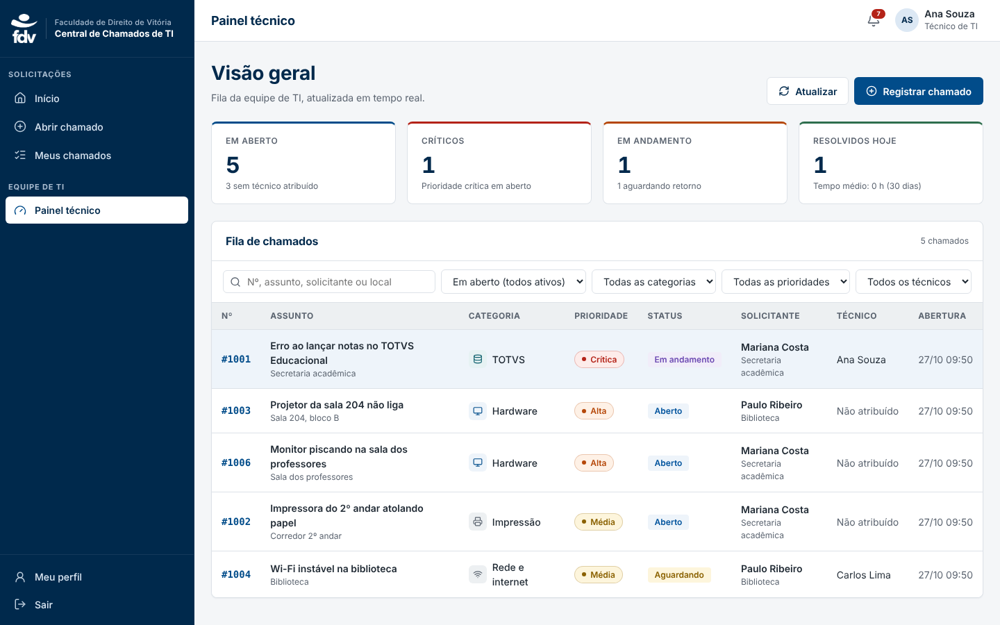
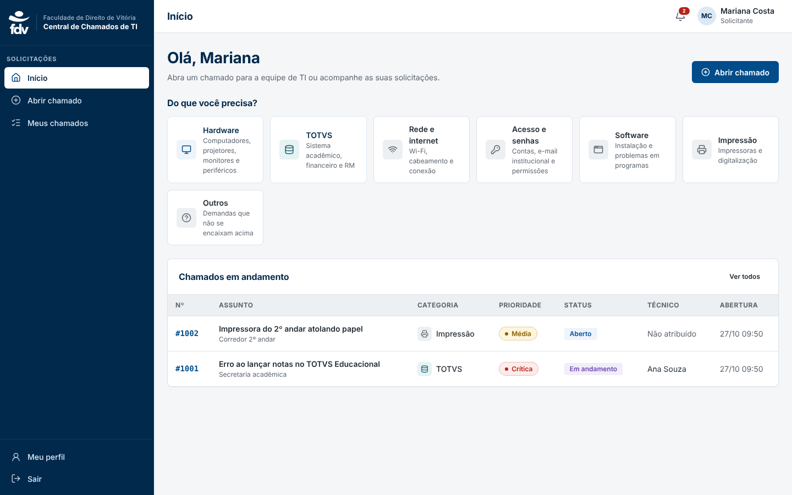
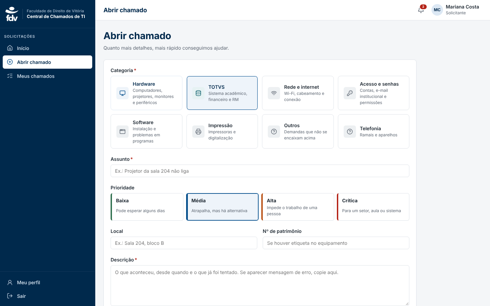
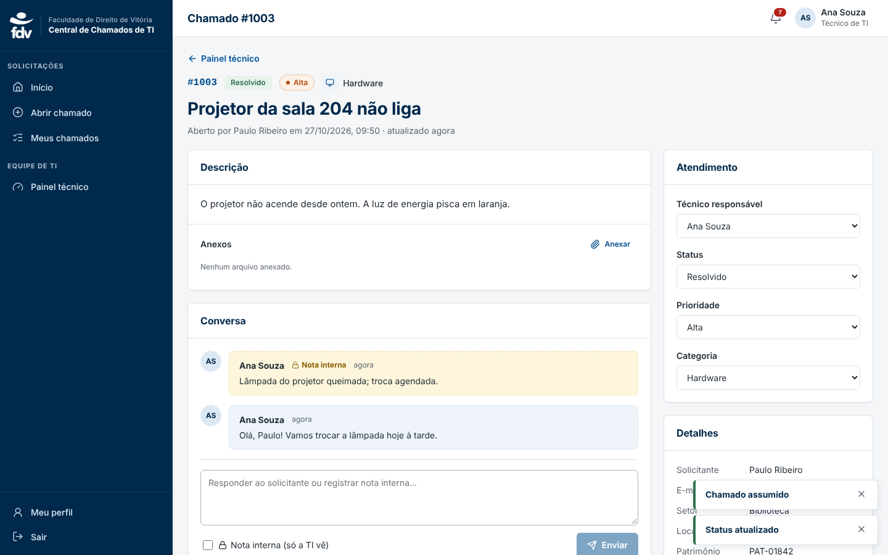
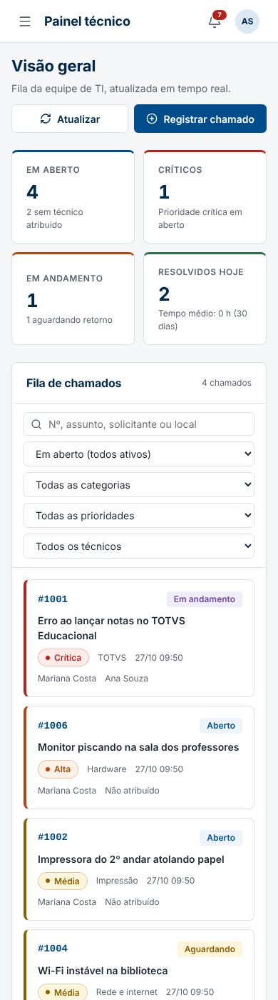

# Central de Chamados de TI — FDV

Sistema interno de chamados de TI da Faculdade de Direito de Vitória.
React + Vite + TypeScript no front-end e Supabase (Auth, Postgres com RLS, Realtime e Storage) no back-end.



## Funcionalidades

**Solicitante**
- Abertura de chamado com categoria (Hardware e TOTVS em destaque), prioridade, local, patrimônio, descrição e anexos (até 5 arquivos de 10 MB)
- "Meus chamados" com abas (em andamento, concluídos, todos) e busca
- Conversa com a equipe de TI dentro do chamado
- Confirmação da solução (encerra) ou reabertura com motivo
- Notificações em tempo real (sino no topo + avisos na tela)

**Equipe de TI (técnico e administrador)**
- Painel com indicadores: em aberto, sem técnico, críticos, em andamento, aguardando, resolvidos hoje e tempo médio de resolução (30 dias)
- Fila ordenada por prioridade e antiguidade, com filtros por status, categoria, prioridade e técnico ("atribuídos a mim", "sem técnico")
- Atribuição de técnico, botão "Assumir chamado", alteração de status, prioridade e categoria
- Notas internas (invisíveis ao solicitante)
- Histórico automático de todas as alterações
- Registro de chamado em nome de outra pessoa (pedidos por telefone)
- Atualização da fila em tempo real

**Administrador**
- Gestão de usuários: papel (solicitante, técnico, administrador) e ativação/desativação
- Gestão de categorias: criar, editar, ordenar, destacar e desativar

## Segurança (RLS)

Todas as regras ficam no banco, não só na interface:

| Quem | Pode |
|---|---|
| Solicitante | ver e abrir **apenas os próprios** chamados; comentar só mensagens públicas; não altera status, técnico nem o próprio papel |
| Técnico | ver e atualizar todos os chamados; notas internas; ver todos os usuários |
| Admin | tudo do técnico + gerenciar usuários, categorias e excluir chamados |

Gatilhos garantem que um solicitante sempre abre o chamado como "Aberto", sem técnico e em seu próprio nome, mesmo que a requisição seja manipulada.
O histórico e as notificações são gravados pelo banco, então não podem ser falsificados pelo navegador.

## Instalação

### 1. Supabase

1. Crie um projeto em [supabase.com](https://supabase.com).
2. Em **SQL Editor**, cole e execute todo o conteúdo de
   `supabase/migrations/20261027120000_central_chamados.sql`.
   Ele cria tabelas, políticas RLS, gatilhos, tempo real, o bucket de anexos e as categorias iniciais.
3. Em **Authentication → URL Configuration**, informe a URL onde o sistema ficará publicado
   (ex.: `https://chamados.fdv.br`) em *Site URL* e em *Redirect URLs* (`https://chamados.fdv.br/**`).
4. Opcional: em **Authentication → Providers → Email**, desative *Confirm email* se não quiser
   exigir confirmação por e-mail no cadastro.

### 2. Front-end

```bash
npm install
cp .env.example .env   # preencha com os dados de Project Settings → API
npm run dev            # http://localhost:5173
```

| Variável | Descrição |
|---|---|
| `VITE_SUPABASE_URL` | URL do projeto Supabase |
| `VITE_SUPABASE_ANON_KEY` | chave pública *anon* |
| `VITE_DOMINIO_EMAIL` | opcional; ex.: `fdv.br` para aceitar cadastro só com e-mail institucional |

### 3. Primeiro administrador

Crie sua conta pela tela "Criar conta" e depois rode no SQL Editor:

```sql
update public.perfis set papel = 'admin' where email = 'seu.email@fdv.br';
```

A partir daí, os demais papéis são definidos na tela **Administração → Usuários**.

### 4. Publicação

`npm run build` gera a pasta `dist/`. Funciona em Vercel, Netlify ou qualquer hospedagem estática
(`vercel.json` e `public/_redirects` já tratam as rotas da aplicação).
Configure as mesmas variáveis do `.env` no painel da hospedagem.

## Estrutura

```
supabase/migrations/      banco: tabelas, RLS, gatilhos, realtime, storage
src/styles/fdv-theme.css  identidade visual FDV (cores, tipografia, componentes)
src/styles/app.css        composição das telas
src/lib/                  cliente Supabase, tipos, formatação, anexos
src/context/              sessão/perfil e avisos
src/hooks/                notificações em tempo real, categorias, equipe
src/components/           layout (menu lateral, topo), listas, etiquetas, modal
src/pages/                login, início, abrir chamado, meus chamados, detalhe, painel, administração
```

## Identidade visual

Cores medidas em www.fdv.br (azul do cabeçalho `#00294C`, azul de destaque `#00539D`, ativo `#014C8A`) e fonte Open Sans.
Não há manual de marca público, então a paleta está centralizada na seção 1 de `src/styles/fdv-theme.css` para ajuste fácil.
O logotipo em `src/assets/logo-fdv.png` é o arquivo oficial do site institucional, usado sem alterações.
Todos os pares de texto e fundo atendem ao contraste WCAG AA.

## Telas

| Solicitante | Abertura | Detalhe (TI) | Celular |
|---|---|---|---|
|  |  |  |  |
